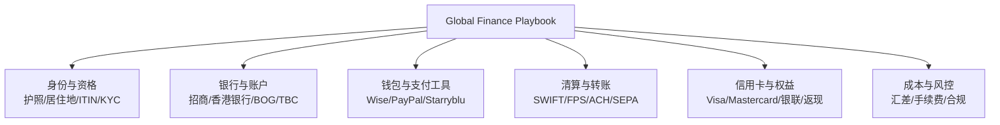
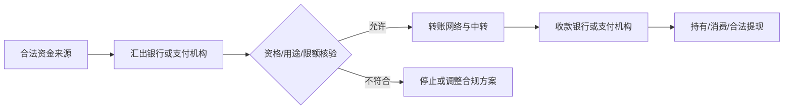

# 全球数字金融手册 · Global Finance Playbook

> **跨境银行 · 信用卡权益 · 支付结算 · 数字钱包 · 海外身份与合规**  
> 一份面向真实生活场景的、持续核验的个人跨境金融知识库。前身：Credit Card Life。

## 这份知识库解决什么问题？

当你跨国旅行、短期生活、留学、远程工作、进行国际订阅或管理境外消费时，真正困难的往往不是“知道某款产品”，而是判断 **自己是否有资格申请、资金能否合规抵达、完整成本是多少、出现失败怎么办**。

本仓库聚焦三个目标：

1. **可达性**：哪些银行账户、卡与数字支付工具，在真实身份和居住条件下可用？
2. **资金效率**：怎样识别跨境收付款链条、手续费、汇差、时效与风控？
3. **权益净收益**：境外消费返现和卡片权益，扣除年费及交易成本后，实际剩下多少？

## 知识版图

**阅读：[完整知识地图](docs/knowledge-map.md)**

## 跨境资金如何流动？

不同通道（SWIFT、FPS、ACH等）有不同适用区域；“拥有卡片”“拥有钱包”“能够收款”“能够提现”是四个不同问题。**[跨境资金流动与成本核算](docs/money-flow.md)** 给出核验字段、潜在路线和实测模板。

## 哪些人会用到？

| 读者 | 最关心的问题 | 推荐内容 |
|---|---|---|
| 境外旅游、短期居住者 | 哪张卡更省？怎么减少汇损？ | [招行返现笔记](notes/cmb/overseas-unionpay-cashback.md) |
| 留学、海外工作与迁居者 | 能否开户、收款、换汇与转账？ | [资金流动模型](docs/money-flow.md) |
| 自由职业者、独立开发者 | 合规接收海外收入、订阅海外服务 | [知识版图](docs/knowledge-map.md) |
| 信用卡权益爱好者 | 返现是否覆盖年费与手续费？ | [招行返现笔记](notes/cmb/overseas-unionpay-cashback.md) |
| 香港银行与美国信用卡研究者 | 港卡用途、信用资格、ITIN与KYC | [美卡入门资料](notes/us/us-credit-card-guide.md) |
| 支付与金融科技从业者 | 银行、钱包、卡与清算网络如何协作？ | [资金流动模型](docs/money-flow.md) |

详见 **[读者画像与价值](docs/audience-value.md)**。

## 文档导航

| 内容 | 链接 | 状态 |
|---|---|---|
| 知识体系与关键概念 | [知识版图](docs/knowledge-map.md) | 已整理框架 |
| 跨境资金路径与费用模型 | [资金流动](docs/money-flow.md) | 研究方法、非已验证通道 |
| 不同读者的实际需求 | [读者画像与价值](docs/audience-value.md) | 已整理 |
| 香港银行、Wise、PayPal、Starryblu等核验任务 | [研究清单](docs/research-backlog.md) | 待核验 |
| 招行银联高端卡境外1%返现 | [原始笔记](notes/cmb/overseas-unionpay-cashback.md) | 已参考官方，活动以最新规则为准 |
| 美国信用卡及ITIN等 | [原始笔记](notes/us/us-credit-card-guide.md) | 第三方资料，部分条款已纠错 |
| 记录新产品与实测 | [笔记模板](templates/note.md) | 可复用 |

## 研究原则

- **官方优先，社区分层**：区分官方确认、第三方线索、本人实测与待验证假设。
- **先资格后路径**：护照、真实居住地、税务资格与KYC条件必须一致；不提供虚假地址、身份或规避风控的做法。
- **计算净成本**：比较手续费、汇率价差、中转费、年费、返现上限与实际到账金额。
- **考虑时间与变更**：开户条件、信用卡权益、平台地区支持和清算网络规则会变化，文章保留查阅日期和有效范围。
- **保护隐私**：不得公开完整卡号、CVV、密码、账单地址、证件或个人交易凭证。
- **不构成金融、税务或法律建议**：真实交易前须核对银行/机构最新要求及适用法规。

## 维护记录

- 2026-10-16：以 Credit Card Life 起步，保存招商银行返现和美国信用卡研究。
- 2026-10-20：扩展为 Global Finance Playbook，增加知识版图、资金流动与读者价值分析。
