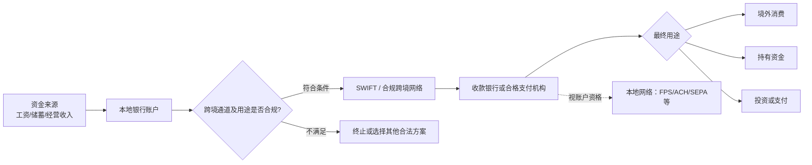

# 跨境资金流动：从资金源头到最终使用

> 本文是资金路径的评估方法，不是已开通的转账指南。更新：2026-10-20。

## 一、资金如何流动

香港 FPS、美国 ACH、欧洲 SEPA 等是特定市场的清算网络，不能简单等同于内地账户直接跨境汇款。国际汇款可能涉及 SWIFT、中转行和本地入账通道。

## 二、每条路径必须填的字段

| 维度 | 必填问题 |
|---|---|
| 发起人 | 账户属于谁？资金是否合法、可提供什么证明？ |
| 汇出 | 银行是否允许该币种、收款机构、用途和目的地？ |
| 中转 | 是否用 SWIFT、参与行网络或服务商中转？ |
| 收款 | 账户/钱包是否接受第三方或本人同名资金？ |
| 币种 | 哪个环节换汇，采用何种报价？ |
| 成本 | 汇出费、中转费、收款费、FX价差、年费与失败退款费 |
| 时效 | 通常用时、截单时间、节假日、退汇周期 |
| 风险 | KYC/AML、制裁、风控、交易限额、冻结和申诉 |
| 证据 | 官方条款、查询日期、测试金额、实际到账情况 |

**净到账金额 = 汇出金额折算值 − 显性手续费 − 汇率价差对应损失 − 其他扣费。** 应以相同汇率基准、同一币种比较不同方案。

## 三、研究中的候选路径

| 候选路径 | 目的 | 当前判断 |
|---|---|---|
| 招商银行 → 香港银行 | 将内地自有资金合法跨境转移 | 需验证购汇/汇款用途、账户资格及实际费率 |
| 招商银行 → Wise | 外币收款或多币种管理 | 需先确认所在地、产品可用性和入金资格 |
| 香港银行 → 合格跨境平台 | 连接港元/美元等资金与其他服务 | 不保证支持所有收款方；核对同名规则 |
| BOG/TBC → 海外收款账户 | 格鲁吉亚账户跨境转账 | 逐行核对转账限制与费用 |
| PayPal（美国区）→ 银行 | 美元余额提现 | 需核对PayPal绑定账户类型、本人资格及支持国家 |
| 合法来源 → Starryblu | 卡消费余额入金 | 需要官方确认受理银行、币种、SWIFT及平台费用 |

**特别提示：** Starryblu页面展示OCBC收款银行，不等于用户在OCBC本人名下开户。不要仅凭收款信息推断PayPal/Wise可直接转入。

## 四、成本比较示例（纯假设，非报价）

同样汇出100美元，如果A路径固定手续费10美元、B路径手续费2美元但额外汇差3美元，其他条件相同，则A成本10美元，B成本5美元。小额转账应特别重视固定手续费比例；大额转账应重点关注汇差与限额。

## 五、实测记录字段

日期｜来源账户国家与币种｜收款机构与币种｜资金用途｜转账金额｜公开报价｜实扣费用｜实到金额｜耗时｜拒绝原因（若有）｜来源链接｜状态。

不公开实名证件、完整账号、信用卡信息、地址及可用于定位个人的凭证。
